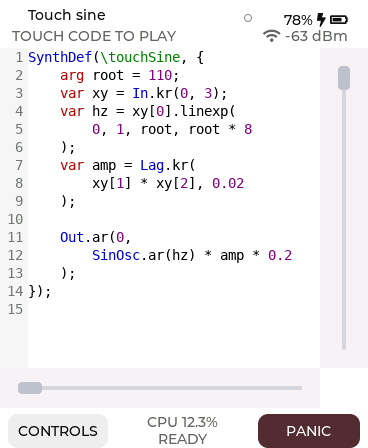
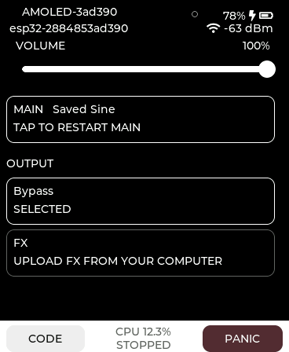

# SynthDefs for ESP32-S3 Touch AMOLED 1.8

Run compiled SuperCollider sounds on a **Waveshare ESP32-S3-Touch-AMOLED-1.8 V2**.
The computer compiles the code; the ESP32 makes the sound. Upload from the local
browser tool or directly from the SuperCollider IDE over USB or Wi-Fi.

For the **headless Seeed XIAO ESP32-S3**, use the separate
[headless build and quickstart](docs/HEADLESS.md).

Each module has **one Main definition, one master FX definition, and FX bypass**.
Use continuous sound Functions, literal SynthDefs, named controls and routed
SuperCollider patterns. The display shows the original source with syntax
colours, touch control input, CPU load, battery, Wi-Fi strength and a green receive
indicator. Controls provides module identity, output volume and Main/FX actions.

| Code / touch input | Controls |
| --- | --- |
|  |  |

*Host-rendered previews from the real LVGL widgets, with example telemetry;
these are layout renders, not live hardware captures.*

## Quickstart

### 1. Prepare the board and host

Use the **V2 board with 16 MB flash, 8 MB PSRAM and a connected speaker**. For a
board that does not yet run this firmware, follow [Build and flash](docs/BUILD.md)
first. The XIAO uses its own 8 MB headless build; other boards require a suitable
hardware adapter and build configuration.

After installing each new module, use the [standard audio check](docs/COMMISSIONING.md)
to verify autonomous sound with the separate master FX slot bypassed.

On the computer, install **SuperCollider** (tested with 3.14.1), Python 3.11+ and
a C compiler (`cc`; on macOS, the Command Line Tools). Then:

```sh
git clone https://github.com/little-scale/esp32s3-synthdef.git
cd esp32s3-synthdef
python3 -m venv .venv
. .venv/bin/activate
python -m pip install -r host/requirements.txt
sh host/studio.sh
```

Keep Studio running. It opens a local browser page; the terminal also prints its
complete session URL. If `sclang` is elsewhere, use
`python host/studio.py --sclang /path/to/sclang` instead.

### 2. Hear your first sound from the browser

1. Connect the board by USB and close other serial monitors.
2. In Studio, select the USB device, connect, and choose **Editing → Main**.
3. Paste this block, **Compile**, then **Upload Main**. Replacing Main replaces
   its previous saved code.

```supercollider
{ SinOsc.ar(220, 0, 0.05) ! 2 }.play
```

The browser's sound-block workflow starts this sound without touch input. Use
**Panic** to stop it and **Restart Main** to start it again. The code display is a
viewer; editing and compilation happen on the host.

Studio's **Output volume** slider adjusts the connected module from 0–100%;
release it to save the level across reboots. Fresh firmware defaults to 20%.
The same slider works with the headless XIAO over USB or paired Wi-Fi.
The **Audio resources** panel shows live average/peak audio CPU load and free
RAM from USB diagnostics. Wi-Fi-only readings are currently unavailable;
missing or stale readings show a dash. See [Studio](docs/STUDIO.md#audio-resources).

### 3. Pair Wi-Fi and identify your module

While connected over USB, open **Wi-Fi setup**, select a **2.4 GHz** network,
enter its credentials, choose a module name and save/pair. Check Wi-Fi, disconnect
USB in Studio, then select **Connection → Wi-Fi**, find modules and connect to the
intended **name and permanent ID**. USB pairing is required for each node.

IDs look like `esp32-001122334455`; they remain stable when the IP changes. The
Controls screen also shows the module name and ID. If broadcast discovery is
blocked, enter the module's IPv4 address in Studio. See [Studio](docs/STUDIO.md)
for setup, fixed Main/FX destinations and reviewed Omni uploads.

### 4. Send directly from SuperCollider

With Studio still running, install the linked extension:

```sh
python host/install_supercollider.py
```

In the SC IDE, choose **Language → Recompile Class Library** once, then evaluate:

```supercollider
ESP32.connect;
ESP32.scan.onDone(_.postln); // Find your paired module IDs.
```

Replace the example ID below with yours:

```supercollider
~node = "esp32-001122334455";

// Upload and create a running instance. No local audio server is required.
{ arg freq = 220, amp = 0.05;
    SinOsc.ar(freq, 0, amp) ! 2;
}.playESP32(~node);

ESP32.set(~node, \freq, 330);
ESP32.module(~node, \volume, 0.5); // Global output scale: 50%.
ESP32.stop(~node);
```

**`.sendESP32(target)` saves a definition silently.** Start that definition with
`ESP32.play(target, args)`, or use `.playESP32(target)` to upload and start in one
step. **Function `.playESP32` blocks also restart automatically after power-up**,
with their initial `args:` saved. Literal SynthDefs keep definition/instance
semantics: their saved definition boots inactive. Browser Function uploads also
start automatically. Recompile the SC Class Library once after this extension
update; existing packages need resending to change their boot behavior.

### 5. Add master FX or route a pattern

FX reads Main's stereo bus 0. Here a Function upload supplies output routing:

```supercollider
{ arg wet = 0.25;
    var input = In.ar(0, 2);
    FreeVerb2.ar(input[0], input[1], wet, 0.8, 0.4);
}.playESP32(~node, stage: \fx);

ESP32.module(~node).fx.set(\wet, 0.4);
ESP32.module(~node).fx.bypass(true);
ESP32.module(~node).fx.bypass(false);
```

For notes, upload a gate-controlled Main. Wait for deployment before starting the
pattern; notes reuse **one monophonic instance**:

```supercollider
(
Routine({
    { arg freq = 440, amp = 0.1, gate = 0;
        (SinOsc.ar(freq) * amp * EnvGen.kr(Env.asr(0.01, 1, 0.1), gate)) ! 2;
    }.sendESP32(~node).wait;

    p = Pbind(
        \type, \esp32Note,
        \module, ~node,
        \midinote, Pseq([60, 64, 67, 72], inf),
        \amp, 0.1,
        \dur, 0.25
    ).playESP32;
}).play;
)
```

Stop the pattern later with:

```supercollider
p.stop;
```

Use `\esp32Set` to automate arguments without sending notes. A `\module` value
can come from `Pseq` or `Prand`; targets accept permanent IDs, aliases, IPv4
addresses, explicit groups or `\all`. For example:

```supercollider
ESP32.alias(\left, "esp32-001122334455");
ESP32.module(\all, \volume, 0.5);
// Sending a Function with .sendESP32(\all) compiles once and uploads the same definition
// to paired online modules and the connected USB module; it does not start instances.
```

[The SC guide](docs/SUPERCOLLIDER.md) covers literal SynthDefs, initial arguments,
Main/FX lifecycle, named Pbindef players, FX patterns and connection recovery.

## Current capabilities and limits

| Area | Current behaviour |
| --- | --- |
| Hardware | Waveshare AMOLED 1.8 **V2**, ESP32-S3 at 240 MHz |
| Audio | 44.1 kHz, 64-frame DSP blocks, float32 internals, mono ES8311 speaker output |
| Routing | Stereo graph bus through Main → FX/bypass → smoothed output volume → mono sink |
| Definitions | One saved Main and one saved FX; legacy numbered slots are archived, not exposed |
| Instances | One Main voice and one FX instance; note patterns are monophonic |
| Code | Compiled SC SynthDef graphs, not the full SC language executing on the board |
| Coverage | 154 native UGen types, 33 unary and 40 binary operators in the pinned FM1 profile |
| Composites | DynKlank, DynKlang, Splay and similar classes expand on the host into supported UGens |
| Limits | 256 nodes, 512 logical signals, 2,048 input references; at most 192 simultaneously live audio buffers; graph and original source up to 64 KiB each |
| Delay memory | Separate 1 MiB PSRAM arenas for Main and FX; admission checks actual rounded allocations |
| Live events | Named scalar/array control values, scheduled notes and cancellation; 16 queued events |
| Wi-Fi | Paired authenticated HTTP; discovery by UDP; targeted and concurrent Omni uploads |
| Control compression | Unchanged float32 values omitted per node/stream/stage; every note retained |

The signal-buffer planner reuses temporary audio buffers and stores each scalar
output in one float. The expanded profile retains 64-frame blocks and the existing
delay budgets. Expanded-profile XIAO checks include a 193-node/200-output
rendering graph and a three-minute Main/FX control soak. Dense graphs can still
exceed the audio deadline; AMOLED timing qualification remains pending. Earlier
board results retain their original build identities. See
[signal storage and expanded graph limits](docs/SIGNAL_BUFFERS.md).

The shared DSP now has exact filter/Lag/unary block kernels. On the tested XIAO,
the filter, Lag and cached-control unary fixtures took about 59%, 60% and 64%
less rendering time; the complete eight-saw/Resonz/MiVerb fixture improved by
about 11%. These are fixture-specific measurements, not universal speedups.
Main replacement uses approximately 5 ms output fades with silence during
loading. See [implementation, comparisons and transition checks](docs/DSP_OPTIMIZATIONS.md).

Supported does not mean every graph fits the audio deadline. Software comparisons,
physical numerical traces, CPU measurements and listening checks are distinguished
in the [support ledger](docs/UGEN_SUPPORT.md) and [extended tests](docs/EXTENDED_TESTS.md).
Some moving-control Rings workloads still overrun. `MiVerb` and other external
SC classes require their corresponding host-side class installations to compile.
Return mono/stereo from a Function, or use `Splay`/`Mix` for larger arrays. Literal
SynthDefs keep authored outputs and must follow the documented bus routing.

The CPU indicator measures **audio processing time against the block budget**,
not combined utilisation of both cores. The receive dot signals valid incoming
control/upload frames; it is not a playback acknowledgement. Module volume is
linear, 0–1 in SC and 0–100% on screen, defaulting to 20% when no level is saved;
SC changes are live, while releasing the physical or Studio slider saves its
value. See [UI](docs/UI.md) and [Studio](docs/STUDIO.md).

## Supported UGens and operators

These are the complete native names/selectors in the current **FM1/cache build**:
**154 UGens, 33 unary operators and 40 binary operators**. Valid rates, parameter
layouts and numerical/CPU qualifications are detailed in the
[support ledger](docs/UGEN_SUPPORT.md); inclusion is not a guarantee that every
graph meets the audio deadline.

The [optimisation register](docs/OPTIMIZATION_REGISTER.md) tracks every native
UGen and operator separately: enabled project changes, inherited FM1 fast paths,
items with no enabled individual optimisation, and disabled experiments. Each
record links the implementation and scoped host/hardware evidence. Update its
JSON source and run `python3 host/document_optimizations.py`; use `--check` to
check inventory coverage and ensure the page is current.

The [complete computer-only review](docs/DSP_OPTIMIZATIONS.md#complete-computer-only-review--4-november-2026)
now covers every supported UGen/operator. Per-fixture desktop gains, regressions,
equivalence checks and code/stack costs are recorded. All seven new candidate
switches remain off; selected ESP32 qualifications are recorded separately and
production DSP defaults are unchanged.
The [hardware test plan](docs/DSP_HARDWARE_TEST_PLAN.md) starts with a bounded
30-minute baseline/candidate session, with extended coverage kept optional.
The [first XIAO results](docs/DSP_HARDWARE_RESULTS.md) record matching selected
replays, mixed target timings and clean PCM5102A listening. Experimental flags
remain disabled in the standard firmware. The subsequent
[fixed-seed XIAO comparisons](docs/DSP_SEEDED_PROFILING.md) cover 28 graphs,
including all six smoothing candidates, partial banks, oscillator/Gendy caches
and nine delay types. They retain both target gains and regressions; current
production settings remain unchanged.

### UGens (154)

```text
A2K               AllpassC          AllpassL          AllpassN
Amplitude         BHiShelf          BLowShelf         BPF
BPeakEQ           BRF               Balance2          BinaryOpUGen
Blip              BlockSize         BrownNoise        Clip
ClipNoise         CoinGate          CombC             CombL
CombN             Control           ControlDur        ControlRate
Crackle           CuspL             CuspN             DC
Decay             Decay2            DegreeToKey       Delay1
Delay2            DelayC            DelayL            DelayN
Dust              Dust2             EnvGen            ExpRand
FBSineC           FBSineL           FBSineN           Fold
Formant           Formlet           FreeVerb          FreeVerb2
FreqShift         Gate              Gendy1            Gendy2
Gendy3            GrayNoise         HPF               HPZ1
Hasher            HenonC            HenonL            HenonN
Impulse           In                K2A               Klang
Klank             LFClipNoise       LFCub             LFDClipNoise
LFDNoise0         LFDNoise1         LFDNoise3         LFNoise0
LFNoise1          LFNoise2          LFPar             LFPulse
LFSaw             LFTri             LPF               LPZ1
Lag               Lag2              Lag3              LagControl
LagUD             Latch             LatoocarfianC     LatoocarfianL
LatoocarfianN     LeakDC            Limiter           LinExp
LinXFade2         Line              LocalBuf          Logistic
LorenzL           MaxLocalBufs      MiMu              MiRings1
MiRings2          MiRings3          MiRings4          MiRings5
MiRings6          MiVerb            MoogFF            MulAdd
OnePole           OneZero           Out               Pan2
Phasor            PinkNoise         Pluck             Pulse
PulseCount        PulseDivider      RHPF              RLPF
RadiansPerSample  Rand              RandSeed          Resonz
Ringz             SampleDur         SampleRate        Saw
Select            SetBuf            SetResetFF        SinOsc
SinOscFB          Slew              StandardL         StandardN
Stepper           Sum3              Sum4              SyncSaw
TExpRand          TIRand            TRand             TWindex
ToggleFF          Trig              Trig1             TrigControl
UnaryOpUGen       VarSaw            WhiteNoise        Wrap
XFade2            XLine
```

`DynKlank`, `DynKlang`, `Splay` and `Mix` are also usable host-side composites:
SC expands them into the supported native UGens. They are not extra native types
in the count above. Patterns and array-building code also run on the host.

### Unary operators (33)

```text
neg            abs            ceil           floor          frac
sign           squared        cubed          sqrt           exp
reciprocal     midicps        cpsmidi        midiratio      ratiomidi
dbamp          ampdb          octcps         cpsoct         log
log2           log10          sin            cos            tan
asin           acos           atan           sinh           cosh
tanh           distort        softclip
```

### Binary operators (40)

```text
+              -              *              div            /
mod            ==             !=             <              >
<=             >=             min            max            lcm
gcd            round          roundUp        trunc          atan2
hypot          hypotApx       pow            ring1          ring2
ring3          ring4          difsqr         sumsqr         sqrsum
sqrdif         absdif         thresh         amclip         scaleneg
clip2          excess         fold2          wrap2          firstArg
```

Operator names above follow the engine's SC selectors. `div` uses floor integer
division, `trunc` uses floor quantization, and `pow` uses the engine's signed-power
behaviour. The support ledger includes selector numbers, tested rates and board
evidence for every operation.

## Testing and development

The [build guide](docs/BUILD.md) provides the current FM1/cache configuration,
flashing/recovery steps and test commands. The latest installed image is recorded
in [STATUS.md](STATUS.md) with matching build and device evidence.

The compact-control change passes full/delta PCM identity tests with interleaved
future events, 300 real EnvGen retriggers, 37 SC/network/control regressions and
muted physical note tests. Typical four-argument note payloads shrink from 52 to
37 bytes when only pitch changes; their ASCII request bodies shrink from 136 to
106 bytes. HTTP/TCP/Wi-Fi headers and event frequency remain unchanged.

## Documentation

The **XIAO ESP32-S3 headless target** now shares the same engine and Main/FX
workflow. It provides stereo I²S, USB-based SC uploads and patterns, output
capture alongside live USB patterns, an activity LED, and a BOOT-button control bus. Use its
separate 8 MB build; see the [headless guide](docs/HEADLESS.md) and
[SC examples](examples/xiao-headless.scd). Physical DAC output, externally driven
ADC inputs and Wi-Fi operation on this XIAO remain to be verified.

- [Build, flash and tests](docs/BUILD.md)
- [XIAO headless build, stereo I²S, USB control and PCM capture](docs/HEADLESS.md)
- [Browser compiler, USB/Wi-Fi pairing and Omni upload](docs/STUDIO.md)
- [SuperCollider sending, instances, module settings and patterns](docs/SUPERCOLLIDER.md)
- [Display and controls](docs/UI.md), [code viewer](docs/CODE_VIEW.md), [touch buses](docs/TOUCH_BUSES.md)
- [UGen/operator support](docs/UGEN_SUPPORT.md), [dynamic banks](docs/DYNAMIC_BANKS.md)
- [Memory](docs/MEMORY.md), [performance](docs/PERFORMANCE.md), [MiVerb](docs/MIVERB_OPTIMIZATION.md), [Saw](docs/SAW_OPTIMIZATION.md), [Rings](docs/RINGS_OPTIMIZATION.md)
- [Test evidence and its scope](evidence/README.md), [current status](STATUS.md)
- [Storage/protocol history](docs/PATCHES.md), [original handover](handover.md), [third-party notices](THIRD_PARTY.md)

Studio and the SC bridge run locally. Pairing keys and connection tokens remain
under Git-ignored `build/host/private/`; firmware stores network settings in NVS.
LAN HTTP is authenticated but not encrypted, so use a trusted network. Source
compilation executes SC language code on the host; compile trusted source.

The project is **GPL-3.0-or-later**. Vendored code and the bundled DejaVu font
retain their original notices; see [THIRD_PARTY.md](THIRD_PARTY.md).
