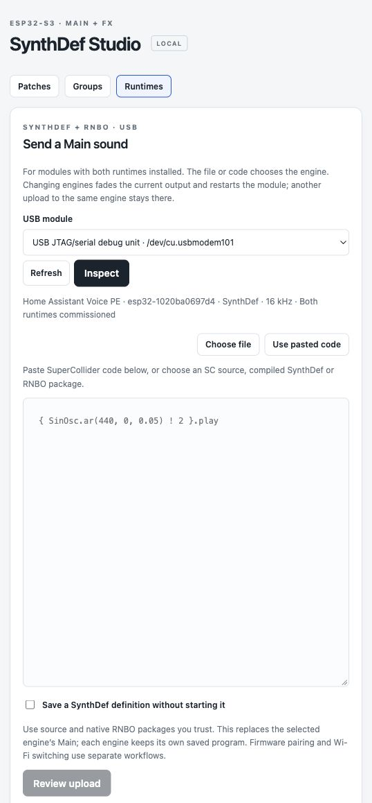

# SynthDef and RNBO on one device

Development checkpoint: 17 November 2026. This is an experimental USB workflow.
Both applications live in flash; only one runs. Selecting the other application
changes its boot record and restarts the ESP32. It does not reinstall either app
or double the running graph's RAM/CPU cost. Switching has an audible gap.

The companion RNBO protocol/updater changes are recorded in
[esp32s3-rnbo commit 14208b4](https://github.com/little-scale/esp32s3-rnbo/commit/14208b4).

## Current qualification

| Capability | Voice PE native 16 kHz | Voice PE 48 kHz | XIAO 44.1 / 16 kHz | AMOLED V2 |
| --- | --- | --- | --- | --- |
| Both runtime images build | Pass | Pass | Pass | Pass, 44.1 kHz |
| Both runtime apps booted | Hardware verified | Pending hardware | Hardware verified at both rates | Simulated; pending hardware |
| Automatic Main payload selection | Hardware verified, muted | Host tested | S→R at 44.1k; R→S at 16k | Host tested |
| Studio Runtimes automatic USB Main upload | Hardware verified, muted | Host tested | Host tested; real 16k connection/inspection pass | Host tested |
| SC Main deployment selects SynthDef | Hardware verified, muted | Host tested | Host tested; SC hardware pending | Host tested |
| Wi-Fi uploads switch engines | Not integrated | Not integrated | Not integrated | Not integrated |

The commissioned VoicePE-0697d4 now has both runtime-aware builds installed at
native 16 kHz. Automatic Main uploads, same-engine uploads without reboot,
busy-transfer and exclusive-USB refusal passed on hardware. Its original
SynthDef graph/source/manifest, RNBO package/paused state, FX bypass/settings and
36% SynthDef volume were restored. Tests were muted; no listening claim is made.
[Automatic handoff evidence](../evidence/voice-pe-auto-runtime-20261116.json).

## Studio: Runtimes tab

Start Studio normally and open **Runtimes**. This view works with already
commissioned USB pairs; firmware pairing remains a separate guarded operation.

1. Select the USB module and click **Inspect**. Studio shows the permanent ID,
   running engine and native rate. It also checks the local pairing inventory.
   Inspection borrows an existing SynthDef USB connection without closing it.
2. Paste SuperCollider Main code, or choose `.scd`, `.sc`, `.scsyndef` or
   `.rnbopkg`. For a quiet SynthDef definition, enable **Save a SynthDef
   definition without starting it**. RNBO startup controls come from its package.
3. Click **Review upload**. Compilation/package validation happens first. The
   review binds those exact bytes to the inspected device, engine and rate,
   displays their hash and tells you whether a restart is needed.
4. Click **Upload Main**. Progress runs in the background and can resume after
   reloading the page. A review expires after ten minutes and can only be used
   once. A lost connection is reported; payload mutations are not blindly retried.

The new view is **USB Main only**. Existing Patches/Groups controls retain their
SynthDef behavior. An RNBO upload leaves that engine running; a SynthDef upload
reconnects the ordinary SynthDef controls automatically. Stop host patterns
before changing engines; their old instance/control bindings are not carried
across a reboot. Another app holding USB causes a clear refusal.

The browser flow was exercised on VoicePE-0697d4 at native 16 kHz, in both
directions, with same-engine uploads and page reload during a real upload.
Original programs, FX state and 36% volume were restored. These tests were muted.
[Studio integration evidence](../evidence/studio-runtime-20261116.json).



## SuperCollider Main deployment over USB

After selecting and inspecting a commissioned USB node in Runtimes, Studio can
keep it discoverable to SC while RNBO is running. `ESP32.discovered` includes the
selected USB row with `runtime: "rnbo"`. Inspection establishes that selection;
this does not silently choose among other plugged-in USB boards.

A valid Main deployment using the existing methods selects SynthDef if needed,
then performs the normal SC upload exactly once:

```supercollider
{ arg freq = 440; SinOsc.ar(freq, 0, 0.05) ! 2 }
    .sendESP32("esp32-1020ba0697d4");
```

Use the permanent ID or a registered alias. Normal target resolution also
includes that USB node when it is a selected group member or a discovered `all`
recipient; Wi-Fi recipients retain their existing SynthDef behavior. No SC
extension recompile is required for this host-side change.

Definition/instance semantics are retained: `.sendESP32` saves a quiet
definition; `.playESP32` on a Function starts the autonomous block. Literal
SynthDefs keep their existing explicit-instance behavior. Arguments and source
are preserved through the same compiler/upload path. FX deployment while RNBO
is selected is refused: send a SynthDef Main first. Notes, `set`, metadata
controls and ordinary discovery never select a different engine.

On VoicePE-0697d4, a real SC client discovered RNBO, confirmed that a control-only
message was refused, then sent a quiet SynthDef Main. The automatic handoff and
verified upload took 65.9 seconds through the guarded maintenance path. A further
autonomous Function upload and frequency-control readback passed. All test
signals were silent/muted and the original setup was restored. This does not
qualify Wi-Fi switching or audible cross-engine transitions.
[SC integration evidence](../evidence/studio-runtime-20261116.json).

## Choose an installed runtime manually

Release Studio's USB connection first. These maintenance commands use exclusive
USB access and enter the ROM loader, even when the requested app is already
selected. Use a normal reconnect if the tool says automatic restart failed.
From the project root:

```sh
sh host/dual_apps.sh synthdef --board voice-pe --mac 1020ba0697d4
sh host/dual_apps.sh rnbo --board voice-pe --mac 1020ba0697d4
```

Substitute `--board xiao` or `--board amoled-v2` and that commissioned device's
exact lowercase twelve-digit MAC. Aliases and group names are not accepted by
these USB maintenance tools. `--port` optionally restricts the matching port;
port names can change after a reboot.

`status` without `--live` inspects flash and also performs a maintenance restart.
New runtime-aware images additionally allow a read-only live query:

```sh
sh host/dual_apps.sh status --live --board voice-pe --mac 1020ba0697d4
```

An older image lacking the common probe is rejected by `--live` without entering
the ROM loader. The probe reports engine, model, native rate and busy state.
It does not play a note or send a parameter change.

## Automatic selection by payload: new USB uploader

`host/dual_upload.sh` accepts SuperCollider `.scd`/`.sc` source, an SCgf compiled
SynthDef, or an RNBO `.rnbopkg`. It compiles/fully validates the payload before
USB access, checks board/rate and the private commissioning inventory, and
identifies the running engine. If necessary it asks the outgoing engine to fade
to zero, verifies the boot selection, reconnects to the required engine and sends
the validated payload through that engine's normal verified upload protocol.
A same-engine upload does not switch applications or reboot.

Disconnect Studio's USB connection before using this standalone uploader. It
does not take ownership away from another client. Cross-engine selection uses
the guarded USB maintenance path and includes a restart; it is not a seamless
or fast live audio switch.

```sh
# Validate only: no USB access or audio playback.
sh host/dual_upload.sh /absolute/path/to/sound.scd \
  --board voice-pe --mac 1020ba0697d4 --rate 16000 --check

# Upload: automatically select SynthDef or RNBO according to validated contents.
sh host/dual_upload.sh /absolute/path/to/sound.scd \
  --board voice-pe --mac 1020ba0697d4 --rate 16000
sh host/dual_upload.sh /absolute/path/to/patch.rnbopkg \
  --board voice-pe --mac 1020ba0697d4 --rate 16000
```

For XIAO/AMOLED use the corresponding board and MAC; their rate defaults to 44100.
For a commissioned native-16k XIAO pair, pass `--rate 16000` explicitly.
For Voice PE explicitly choose 16000 or 48000 to match **both installed apps and
XMOS**. This workflow does not change XMOS, resample an incompatible package or
switch native rate. SynthDef uses 64-frame DSP blocks; the RNBO player uses its
256-frame package profile.

SynthDef `--target fx` installs the separate FX definition. `--definition` saves a
SynthDef without starting an instance. RNBO packages contain their own effects;
those two options are rejected for RNBO. Source uses the existing Studio compiler
and supported Function/SynthDef/program forms, not arbitrary live SC interpreter
state. Compiling source can require SuperCollider extensions such as MiVerb.

Both applications must first be commissioned with the tools below. Their private
inventory is local to this checkout; do not invent an inventory for an unknown
board. RNBO package validation/transport uses the companion `esp32-rnbo` or
`esp32s3-rnbo` checkout beside this project. Set `RNBO_PROJECT_ROOT` explicitly if
it is elsewhere. Launchers select the installed ESP-IDF Python environment.

The default route requires the **new runtime-aware images on both sides**. Older
images are refused before boot selection because their upload/busy state cannot
be queried safely. `--allow-legacy-reboot` is an explicit maintenance fallback,
with Studio disconnected; it cannot provide the outgoing engine's acknowledged
fade. Notes, parameter changes, discovery and identify never trigger an engine
switch. A failed fade/boot prevents sending to the wrong runtime; mutations are
not blindly replayed after a reboot.

Studio's Runtimes view and SC Main deployments to its inspected USB node now use
this same validated routing path. RNBO-specific frontends still require their
matching runtime. Wi-Fi switching and Max frontend integration remain future
work. A Wi-Fi handoff will also need both applications' network provisioning and
pairing to work after the reboot.

Cross-engine handoff uses each target app's normal startup behavior. SynthDef
can resume its previously saved continuous Main before the incoming upload
finishes. A dedicated quiet-boot handoff is not implemented, and these muted
checks do not establish click-free transitions at normal output levels.

## Commission a Voice PE pair

First install the guarded SynthDef app in app0 using the existing
[Voice PE recovery/update procedure](../ports/voice_pe/RECOVERY.md). Match the
local SynthDef build to the installed rate. Then install the same-rate RNBO player
in app1, using the correct board's reviewed player binary:

```sh
sh host/voice_pe_apps.sh install-rnbo --mac DEVICE_MAC --rate 16000 \
  --image /absolute/path/to/rnbo_s3_voice-pe.bin
```

The installer requires the reviewed project table and verifies that installed
SynthDef exactly matches its locally validated same-rate build. It validates the
RNBO image/profile, privately backs up the whole app1 and OTA records, checks an
unused slot is wholly erased, writes app1 and verifies protected regions.
It preserves the selected app, bootloader, partition table, SynthDef, storage,
NVS and XMOS. It also refreshes the private commissioning inventory.

The current physically verified native-16k pair is:

| Slot | Offset | Capacity | Installed image bytes |
| --- | ---: | ---: | ---: |
| app0 / SynthDef | `0x10000` | `0x7c0000` | 1,255,872 |
| app1 / RNBO | `0x7d0000` | `0x3c0000` | 987,232 |
| Shared storage | `0xb90000` | `0x400000` | Separate files per engine |

RNBO booted with `boot_verified:true`, its saved VoicePELED package and paused
state. SynthDef then booted at DSP/output rate 16000 with its saved continuous
SoundBlock and `reset_required:false`. These were boot/state checks, not a new
listening qualification. [Hardware evidence](../evidence/voice-pe-dual-runtime-20261116.json).

For later RNBO app1 updates reuse `install-rnbo` with a matching local SynthDef
build. To update SynthDef, select SynthDef first and use its guarded app0 updater;
then refresh the inventory through the verified companion installation workflow.
The older app0-only RNBO updater refuses a paired board. Do not erase/install a
pair to perform a normal update. Keep all private recovery receipts.

## Commission XIAO and AMOLED V2 pairs

These tools require an existing recognized project firmware and reviewed factory
partition table; blank/unknown boards are rejected. First provision a fresh board
with its normal single-runtime installer. Build both board-specific runtimes,
then review the layout without connecting hardware:

```sh
sh host/dual_apps.sh plan --board xiao \
  --synthdef-build firmware/build-xiao \
  --rnbo-build ../esp32-rnbo/build/firmware-xiao-player-dual-runtime
```

Replace `plan` with `setup --mac DEVICE_MAC` for the initial USB migration. For
AMOLED use `--board amoled-v2`, `firmware/build-instrument` and the companion
`build/firmware-amoled-player-dual-runtime` directory. Build folders must include
metadata/configuration and matching binaries, not just copied `.bin` files.
The tools verify image digests/board identities, RNBO build provenance, sample
rate, player console profile, filesystem compatibility and size limits first.

The layout splits the previous application region into two 64 KiB-aligned slots.
OTA records occupy `0x300000`–`0x301fff`; NVS remains at `0x9000`, PHY at `0xf000`,
and storage stays at `0x310000`, ending at 8 MiB on XIAO / 16 MiB on AMOLED.
Storage is neither moved nor shrunk. Current build pairs fit in app0 capacity
`0x1b0000` and app1 capacity `0x140000` (app1 starts at `0x1c0000`). Future builds
are checked again; AMOLED's spare application space is small.

Before writing, setup creates a full verified private flash backup. It installs
RNBO into the unused tail of the old app area, selects it in OTA metadata,
changes the table, writes SynthDef, verifies both apps/protected regions and
selects SynthDef. The simulated interruption after the table change leaves RNBO
available. **The initial partition-table change is not power-loss atomic**;
a loss during that write can require ROM recovery from the full backup. This
migration has not yet been performed on physical XIAO/AMOLED hardware.

Later updates use `update --engine synthdef` or `update --engine rnbo`, with the
same two complete build-folder arguments and `--mac`. The installed slot sizes
are retained; oversized images are rejected. The other verified app is selected
during the write, and the previous selection is restored after verification.
The ordinary SynthDef factory uploader refuses a dual-app partition table.
The companion RNBO updater also rejects its non-factory table. Avoid any
first-install/erase workflow on a commissioned pair.

## Preservation and failure handling

Switching writes one verified OTA sector while retaining the other valid record.
It preserves application bytes, settings and patch storage. Firmware updates and
commissioning retain private backups and reject secured/encrypted devices.
SynthDef and RNBO keep separate saved programs and settings; changing engines
does not convert their patches. Both builds must agree on SPIFFS format. A new
SynthDef mount guard refuses to format nonempty storage if mounting fails.

Private backups/inventories may contain credentials and remain Git-ignored under
`recovery/voice-pe/private/dual-apps` or `build/host/private/dual-apps`. They are
recovery assets, not disposable build caches. If verification fails, retain the
receipt and inspect the board before retrying; do not replace the partition table
with a generic one. Application switching does not promise automatic fallback
from every runtime fault.

[Computer-only verification and artifact hashes](../evidence/dual-runtime-computer-20261116.json).

## Next hardware session: short qualification sequence

1. Disconnect Studio USB, record the current engine, saved Main/FX or RNBO
   package and each engine's output setting; retain the private backups. Install
   the two matching runtime-aware images without changing XMOS.
2. Query `status --live`, then upload a silent SynthDef and a muted RNBO package
   in turn. Confirm the expected engine/rate and verified saved-payload digest
   after each switch. Repeat the RNBO upload: this must stay in RNBO without a
   boot-selection write. Repeat in the opposite direction.
3. Send a malformed package and a wrong-rate package. Both must fail before
   booting or modifying the saved program. Confirm another USB owner and an
   in-progress transfer cause refusal rather than a forced reboot.
4. Restore the user's exact saved program/output settings, unplug/reconnect
   normally, and verify the selected engine and saved program return. Do a brief
   listening check only when someone is available.
5. Repeat on XIAO and AMOLED after reviewing the computer-only `plan` output.
   Their first partition-table migration needs a full recovery backup and stable
   power; it is a separate qualification from ordinary payload handoff.

Do not use the user's current audible patch as a silent test fixture or overwrite
it without retaining a restorable copy. Steps 1–4 have now been exercised in the
resumed native-16k Voice PE session, including muted PCM capture and original
program restoration. The 48 kHz pair, automatic FX handoff, listening checks and
physical XIAO/AMOLED migration remain separate qualification work.


## XIAO native 16 kHz pair

The matching RNBO player and PCM5102A checks are recorded in
[esp32s3-rnbo commit 65dba0a](https://github.com/little-scale/esp32s3-rnbo/commit/65dba0a).

XIAO now has separate matched SynthDef/RNBO builds at **44.1 kHz** and
**16 kHz**, with the PCM5102A as the initial low-rate DAC. There are two runtime
slots, not four. Changing engines selects an installed app and reboots; changing
rates updates the pair's application images through the guarded updater.
A payload never silently changes the device's sample rate.

Build the SynthDef side with `bash host/xiao_native16.sh build`. In the companion
RNBO project, use:

```sh
python3 tools/build_firmware.py xiao --player --variant dual-native16 \
  --profile voice-pe-16000-256-v1
```

The historical `voice-pe-16000-256-v1` identifier is the shared 16 kHz/256-frame
RNBO package ABI, now also admitted on XIAO. It does not select Voice PE hardware
or expose its physical controls. RNBO native exports/packages must actually be
compiled for 16 kHz; changing a package header is not a conversion. SynthDef
continues to use 64-frame blocks (4 ms); RNBO uses 256-frame callbacks (16 ms).
Both generate native 16 kHz I²S master output on XIAO, with 16-bit PCM in 32-bit
slots so the PCM5102A receives its required 64-fs BCLK. No XMOS step is involved.

For a factory-layout XIAO, use `host/dual_apps.py plan/setup` with these matching
build folders, following the existing commissioning procedure. For an existing
pair, use `update --engine synthdef` and then `update --engine rnbo`, supplying
both matching build folders each time. Never run the factory installer over a
paired layout. Each update backs up the app/boot record, retains the other
verified runtime as the recovery selection while writing, checks protected
regions and restores the previous selected engine.

New images carry an explicit native-rate marker checked against build metadata.
The inventory records each application's rate. During the intermediate state of
an update, the two apps can have different rates; automatic payload routing is
blocked until both match. Manual selection/status reports the selected app's
actual rate. Older unmarked XIAO/AMOLED images are treated as their historical
44.1 kHz profile. Unknown/conflicting rate markers are rejected.

Settings and the storage partition retain their addresses and geometry. A saved
RNBO package compiled for the old rate is not retagged; upload a matching package
after changing rates. Physical control bindings at 16 kHz need separate coverage.


### XIAO hardware checkpoint

On 17 November 2026, XIAO-3eeb84 and its PCM5102A passed the four playback
combinations: SynthDef/RNBO at 44.1 kHz and at 16 kHz. The user confirmed clean
sound at 20%. Automatic S→R upload at 44.1k and R→S upload at 16k passed;
Studio then connected and inspected the completed native16 pair successfully.
Updates preserved boot/settings/storage regions and the original Main was
restored exactly. The unit was left in SynthDef 16k, FX bypassed, 20% saved volume.
There are no external clock measurements or physical cold power-cycle results
for this session. Full-rate DSP equivalence, all UGens at 16k and network load
are not implied by these tone tests. [Detailed evidence](../evidence/xiao-dual-rate-hardware-20261117.json).
