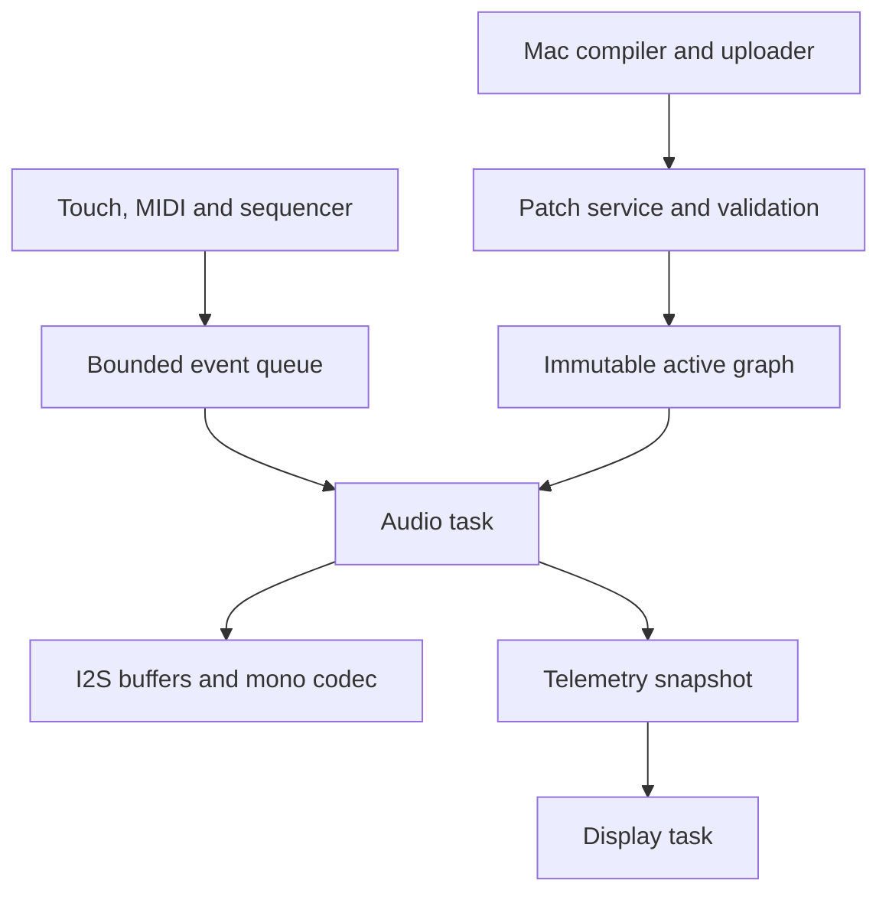

# Waveshare AMOLED SynthDef Instrument Technical Handover

Prepared for Sebastian Tomczak and the local implementation agent. 30 October 2026, Australia/Adelaide.

Status: implementation specification and research handover. No ESP32 firmware has been built, flashed or benchmarked as part of this handover. Proposed defaults and acceptance thresholds below are engineering decisions for the new project, not measured capabilities.

## 1. Objective and first deliverable

Port the existing embedded SuperCollider SynthDef runtime from `little-scale/fm1-synthdef` to the Waveshare **ESP32-S3-Touch-AMOLED-1.8**, producing a standalone, battery-capable touchscreen instrument. The computer compiles SuperCollider source; the device loads and executes the resulting supported UGen graph. Audio synthesis takes place on the device, not in the browser or through streamed computer audio.

The first useful release should play existing compatible `.scsyndef` patches, expose four live synth controls and a note trigger, offer saved patch selection, and reliably produce sound through the board's mono audio path. Begin with one voice. Add a second voice and a master effect only after measurement establishes sufficient CPU and memory headroom. A touchscreen sequencer, motion controls, network transfers, microphone effects and stereo expansion are subsequent milestones.

This is a native ESP32-S3 port of the engine. It is not FM1 emulation, a pi32v2 compatibility layer, a full SuperCollider server, or an attempt to run `sclang` on the microcontroller. Reuse the work already completed in the engine rather than translating each patch into new hand-written synthesis code.

The user intends to create a local project. Treat this file as its initial `HANDOVER.md` or project specification. No remote repository creation, publishing, or changes to the FM1 repository are needed to begin.

### First demonstrable result

An existing gated sine SynthDef loads on the board, a large touch pad triggers and releases it, frequency and amplitude controls work, and the audio remains clean while the UI updates. Logs report the actual sample rate, engine block size, render-time maximum, output failures, memory allocations and build identity.

## 2. Evidence baseline and source discipline

The FM1 repository was inspected at commit **`00ac338904304e87845477808e598ef973f49b52`**, whose commit timestamp is 2026-10-29 23:02:09 UTC. Use this as a reproducible starting point; inspect subsequent changes deliberately before adopting them. Sources are listed in section 24.

Labels used in this handover:

- **Verified source fact:** observed in the repository or official documentation. This does not necessarily mean verified on physical hardware.
- **Proposed design:** the intended implementation approach for the new port.
- **Hardware gate:** must be resolved on the actual board before claiming support or performance.

### Latest repository recheck

The repository was checked again during handover preparation at the user’s request. One new commit, `00ac338` (Add synthesis oscillators, plucked strings and bus effects), superseded the initial 142-type snapshot. This handover now pins that 154-type commit. The public rendering API, 64-frame block and fixed graph/voice structures remain unchanged in that diff. The new `fm_expansion.inc` must be included. The renderer also stops processing downstream nodes after an earlier node faults; preserve that behavior.

The latest root README reports 1,444 reference cases across three rendering backends, 80 API test groups and 1,560,000 sanitizer mutation/truncation cases. These are upstream-reported results, not tests rerun for this handover and not ESP32 results. The newest 77 additions still await hardware timing/listening checks according to that README.

### Important repository inconsistency

At the inspected commit, the root README and engine source describe/include 154 UGen types. However, `synthdef-engine/profile.json` still lists 118 types and contains obsolete statements about MiRings being unimplemented. `docs/COMPATIBILITY.md` also says 118. The loader and header include the six separate Rings models, later random/chaotic generators, and the latest synthesis/effects expansion. The latest commit adds 12 types: SinOscFB, Blip, Phasor, Pluck, MoogFF, FreqShift, Limiter, FBSineN/L/C and StandardN/L.

Do not blindly use the existing JSON profile as the new device's capability contract. Reconcile the enum, loader table, implemented kernels, fixtures and documentation. Generate a target-specific capability manifest from the actual selected build, and add a consistency check. Distinguish a type being compiled in from that type having passed ESP32 hardware timing tests. The development README also distinguishes the newer source from the published 53-type preview firmware and earlier hardware-tested builds.

Existing test counts and FM1 hardware measurements are upstream evidence, not ESP32 acceptance results. Several documentation sections retain older milestone counts. Preserve the upstream reports, but record new results with the exact commit, compiler and target configuration.

## 3. Hardware target and confirmation checklist

Assumed product: **Waveshare ESP32-S3-Touch-AMOLED-1.8**, not a bare AMOLED panel, the round 1.75-inch product, or a similarly named LCD board. Obtain the exact product link and rear-label/revision information when hardware is available. [S7–S9]

| Item | Documented target hardware | Port implication |
| --- | --- | --- |
| MCU | ESP32-S3, dual-core Xtensa LX7, up to 240 MHz | Native ESP-IDF firmware; do not use the JieLi toolchain |
| Internal SRAM | 512 KB total | Not all available as application data heap |
| PSRAM | 8 MB | Useful for larger allocations, subject to bandwidth/cache constraints |
| Flash | 16 MB | Partition for application, settings and patch files |
| Display | 1.8-inch, 368 × 448, QSPI AMOLED | New touch UI; partial redraws preferred |
| Original revision | SH8601 display, FT3168 touch | Use matching BSP support |
| V2 revision | CO5300 display, CST820 touch | Do not identify it as CST816 merely because a driver has that family name |
| Audio | ES8311 codec, microphone and speaker path | Mono analog audio; configure codec and I²S together |
| IMU | QMI8658 | Accelerometer/gyro controls, later milestone |
| Power | AXP2101, battery connector/charging | Battery-aware portable operation |
| RTC | PCF85063A | Optional clock/timekeeping; not the musical timing source |
| Storage | microSD | Optional patch bank; not required for initial audio |

Hardware gate: confirm what the exact purchased package includes, especially enclosure, battery and speaker arrangements. Do not assume a convenient stereo headphone socket or solder-free external DAC connection.

### Audio is mono

ES8311 is a mono ADC/DAC codec. A differential analog output pair is not a stereo pair. Retain stereo float rendering internally so existing graphs and effects keep their semantics, then downmix deliberately for the speaker. A conservative initial conversion is `mono = 0.5f * (left + right)`, followed by master gain, finite-value handling and clipping before integer conversion. Stereo phase cancellation is possible; test patches with wide or inverted stereo content. [S10]

Do not wire the speaker-amplifier output directly to an interface or headphones. Establish the available codec-level output and its electrical requirements from the revision-specific schematic before adding a line output. External stereo output is an expansion task, not part of the first milestone.

### Pin mapping policy

Take pin assignments from the selected official BSP and matching schematic. Do not copy a pin list from an unrelated ESP32 board or a third-party project. Maintain a local `docs/BOARD.md` table with each signal, GPIO or expander bit, polarity, peripheral owner, BSP constant, source revision and hardware test result. Include display reset, touch reset/interrupt, codec clock/data, amplifier enable, SD, power enable and USB. Shared I²C ownership must be explicit.

## 4. Existing project components to reuse

| Path in upstream repository | Role | Port treatment |
| --- | --- | --- |
| `synthdef-engine/src/fm_synth.h` | Structures, limits and public API | Preserve initial ABI/limits; measure target `sizeof` values |
| `synthdef-engine/src/fm_load.c` | Version-2 SynthDef parser and validation | Reuse; validate untrusted transfer bytes before activation |
| `synthdef-engine/src/fm_render.c` | Float DSP runtime | Build as native C99 for ESP32 |
| `synthdef-engine/src/*.inc` | Kernels, tables and helpers | Include all files referenced by the renderer; retain notices |
| `synthdef-engine/tests/` and `fixtures/` | Regression and reference corpus | Retain as baseline; add target-render comparison harness |
| `synthdef-engine/tools/` | Inspection, rendering and fixture export | Reuse on host where applicable |
| `fm1-synth/src/performance.c` | Voice allocation, controls, effects and rendering | Useful reference; requires sample-rate and hardware-policy refactoring |
| `fm1-synth/firmware/` | FM1 adapter, display, transfer and storage integration | Do not compile wholesale into ESP32 firmware |
| `fm1-synth/firmware/device_include/math.h` | FM1 freestanding math replacement | Benchmark separately only if needed; not the initial ESP32 default |
| `fm1-synth/firmware/runtime.c` | FM1 libc replacements | Exclude from ESP-IDF to avoid overriding its standard library |
| `fm1-base/` and JieLi dependencies | FM1 platform/BSP/build support | Not required by the initial native ESP32 engine build |

The host Makefile builds `fm_load.c` and `fm_render.c` with C99 and `-fno-fast-math -ffp-contract=off`. It targets macOS-style shared-library naming. Its reference tooling also uses C++17 for some independent DSP oracles; that does not imply the embedded engine itself needs C++17. [S2–S5]

### Concrete portability issue in the performance adapter

`performance.c` hard-codes 44100 in allocation checks, `fm_start`, and effect setup. It also uses 441000 for a ten-second release cap, 44100 for a clip indicator duration, and sample-based fade/smoothing constants. Do not change only the I²S sample rate and assume the instrument is ported.

Proposed approach: first run at 44.1 kHz if the board's codec/clock configuration supports it cleanly; then introduce a single instrument configuration containing sample rate, voice limit, preparation policy, arena limits and fade durations. Audit every time-dependent value. The engine already receives a sample rate through `fm_start`; the instrument adapter needs the same discipline.

## 5. Repository and build structure

Create a separate local project, tentatively named `waveshare-synthdef`. Keep the engine pin and a small, reviewable port layer. A Git submodule, subtree or vendored snapshot can work; choose one and record its update procedure. Do not copy the entire FM1 platform into the ESP32 application merely to reuse two C files.

Proposed layout:

| Path | Contents |
| --- | --- |
| `README.md` | Setup, supported hardware, current acceptance status |
| `HANDOVER.md` | This specification, updated as decisions are resolved |
| `firmware/CMakeLists.txt` | ESP-IDF project entry |
| `firmware/sdkconfig.defaults` | Deliberate target defaults |
| `firmware/partitions.csv` | Reviewed flash layout |
| `firmware/main/` | Startup and application orchestration |
| `firmware/components/synthdef_engine/` | Build wrapper around pinned upstream engine |
| `firmware/components/instrument/` | Voices, controls, scheduling, effects |
| `firmware/components/board_audio/` | BSP/codec/I²S bridge |
| `firmware/components/patch_store/` | Validated package storage and selection |
| `firmware/components/transfer/` | USB protocol and optional network backend |
| `firmware/components/ui/` | LVGL screens and event production |
| `firmware/components/motion/` | Later IMU calibration and mappings |
| `upstream/` | Pinned source and provenance records |
| `host/` | Compilation, preview and upload adapter |
| `examples/` | Small supported patches and manifests |
| `tests/` | Host adapter tests and target capture tooling |
| `evidence/` | Versioned hardware logs, timings and numerical comparisons |
| `docs/` | Board, protocol, memory, compatibility and recovery notes |

Use ESP-IDF rather than an Arduino sketch as the primary implementation. Waveshare's current getting-started guide documents ESP-IDF 5.5.x and 6.0.x examples and the managed BSP `waveshare/esp32_s3_touch_amoled_1_8`. At inspection it gives `^2.0.3` as the BSP dependency range. Select an available, working release pair and pin the resolved versions after board bring-up; do not depend indefinitely on moving `stable` documentation or unconstrained package ranges. [S8]

The new application's dependency lock is its own generated state. Do not copy another example's lock blindly. Once validated, retain the application lock, configuration defaults, compiler identity and BSP version for reproducibility. Decide deliberately whether a full `sdkconfig` is committed; defaults and a recorded configuration hash should always be available.

Example initial commands, run in the appropriate local checkout with the chosen ESP-IDF environment activated:

```bash
# First: use the vendor example, before integrating synthesis.
cd examples/esp-idf/00_board_check
idf.py set-target esp32s3
idf.py build
idf.py -p PORT flash monitor

# Later: use the new project's firmware directory.
cd /path/to/waveshare-synthdef/firmware
idf.py set-target esp32s3
idf.py build
idf.py -p PORT flash monitor
```

`PORT` and `/path/to/...` are placeholders. Do not infer the user's serial device. Use the observed port and normal ROM download procedure. The vendor quickstart also provides `00_bsp_quickstart` for display/touch verification.

## 6. Software architecture and ownership



Proposed ownership rules:

- The audio task alone mutates active voice state, live DSP controls and the active effect state.
- A graph is immutable once published to the audio task. No loader writes into a playing graph.
- The patch service owns staging buffers and persistent files. It sends a validated activation request, then waits for acknowledgement before reclaiming replaced memory.
- UI and MIDI code produce events; they do not call `fm_set` on a voice concurrently with rendering.
- Telemetry is copied into a bounded snapshot; the display does not inspect changing voice internals without synchronization.
- One scratch buffer may be reused across voices rendered serially. Parallel voice rendering would require separate scratch and a fresh ownership analysis.
- Retired graphs and arenas are freed only after audio has acknowledged that no voice or pending request can reference them.

Use a small state machine for activation: `RECEIVING → VALIDATING → READY → ACTIVATING → ACTIVE`, with explicit failure/cancel paths. A failed upload or invalid patch must not destroy the current playable patch.

## 7. Audio pipeline

### Initial configuration

Keep `FM_BLOCK = 64`. Prefer 44.1 kHz initially to match the current instrument adapter and fixtures, if verified codec clocks permit it. If starting at 48 kHz is necessary, refactor sample-rate assumptions before comparing sound or timing. Neither rate is established on this board by this handover.

| Quantity | At 44.1 kHz | At 48 kHz |
| --- | --- | --- |
| 64-frame engine block | 1.451 ms | 1.333 ms |
| 128 frames | 2.902 ms | 2.667 ms |
| 256 frames | 5.805 ms | 5.333 ms |

These are computed durations, not end-to-end latency. Codec filtering, touch polling, event scheduling, startup preparation and queued output all contribute additional delay.

Use one codec/I²S owner. Either use the BSP's codec-device write path or a deliberately integrated lower-level I²S path; do not initialize duplicate drivers on the same peripheral. Confirm sample width, slot width, slot selection, channel packing, MCLK, BCLK and WS from the actual BSP and codec configuration. A mono codec may still require a two-slot I²S frame. Test left-only and right-only patterns to establish what it consumes. [S10–S11]

### Render sequence

1. Wait for output-buffer capacity or an appropriate notification.
2. Apply due note/control/activation events according to the block scheduling policy.
3. Clear the stereo mix once.
4. Render each active synth voice serially into the mix or a temporary block as required by the voice-fade policy.
5. Render the master effect into a separate output buffer with the synth mix as immutable input.
6. Apply master gain, finite checks and bounded output handling.
7. Downmix stereo for the mono sink and convert to the agreed PCM representation.
8. Submit the buffer, checking errors and partial writes; advance the logical timeline consistently.
9. Update lightweight counters; publish detailed logs from a lower-priority task.

`fm_render` adds to the destination. Failing to clear it creates unintended accumulation. `fm_render_input` expects the supplied input block to remain immutable during rendering; do not alias input and output without explicitly proving support.

### Task design

Start with a high-priority, explicitly pinned audio task on one core and lower-priority UI/control services primarily on the other. Exact affinity and priority numbers are selected after inspecting BSP/IDF tasks. Do not move vendor system tasks arbitrarily or use the maximum priority simply because audio is important.

An ISR should notify or account for buffer progress, not execute SynthDef DSP, parse patches, print logs, allocate memory or manipulate LVGL. Keep floating-point DSP in task context and confirm the pinned IDF's FPU/context-switch rules. [S12]

Render in a bounded loop that blocks when the queue is sufficiently full; a permanently spinning high-priority producer can starve other tasks. Keep the watchdog enabled and solve actual starvation rather than disabling it.

Prohibited in the steady-state rendering path: heap allocation/free, flash writes, SD operations, JSON parsing, network sends, display locks, unbounded queue draining, string formatting and waiting for a UI-owned mutex. Allocation-free DSP still has expensive initialization: `fm_start` clears state and `fm_bind_delay` clears memory. Measure note-on cost separately from sustained rendering.

### Buffer sizing and performance gate

Start conservatively with an output queue containing a small measured number of blocks, then reduce it once stable. If the hardware write unit is 256 frames, render four 64-frame blocks while servicing events at each engine boundary. Do not accidentally quantize events to the larger DMA/write unit.

Proposed acceptance target for a selected performance preset: worst observed combined render/conversion time remains below 70% of its audio-duration budget during the defined stress test, with zero verified output underruns. This margin is a project target, not a proof of all future workloads. Measure initialization bursts and cache effects as well as steady state.

DMA completion or a successful write call alone may not reveal every audible underrun. Correlate queue starvation counters, driver errors and external recordings. Never silently repeat stale audio as if playback were healthy.

## 8. Timing, note preparation and sequencing

Maintain a 64-bit sample-frame timeline owned by the audio task. Distinguish the frame currently being rendered from the estimated frame being played at the codec; they differ by queued output. UI playheads should follow the playback estimate, not jump ahead to the render frontier.

### Initial event timing contract

The existing engine API renders complete 64-frame blocks and exposes no sample-offset note/control event API. Initially apply events at the next eligible block boundary. This produces an additional scheduling quantization of less than one block for an event available before that boundary, plus input/queue delays. Do not call this sample-accurate event scheduling.

For sequenced events, compute ideal times in sample frames and quantize each absolute event time to a block boundary. Do not repeatedly round each step duration and add the rounded result: that accumulates drift. Use fixed-point or a retained fractional accumulator for musical time. For sixteenth notes, the ideal interval is `sample_rate * 60 / (BPM * 4)` frames. Tempo changes need a documented phase-preservation policy.

Sub-block note starts would require a new renderer/adapter design with explicit event offsets and tests for control interpolation, triggers, envelopes and shared effect timing. Rendering 64 frames and discarding part of the result is not a valid general substitute because it advances internal state. Changing `FM_BLOCK` also changes control-rate semantics and memory use. Neither modification belongs in the initial port.

### Preparation latency

The FM1 performance adapter can reserve startup blocks for `fm_prepare`; the earlier instrument description includes a 128-frame preparation interval. It also fades note starts/steals over 128 frames. These are separate from output-buffer latency. Copying the adapter can therefore add onset delay even when the raw engine is fast enough.

Measure constructor and buffer-clear cost. Initially preserve predictable behavior, report it, and then decide whether preparation can happen in a bounded pre-start phase. Sequenced notes may be prepared ahead of time only if their voice state and memory ownership are unambiguous. Interactive notes cannot be assumed to have advance notice.

### Event queue policy

Use a bounded queue with event type, producer/note identity, target frame or immediate flag, parameter/value and sequence number. Define same-time ordering: panic/stop, releases, patch changes, controls, then new notes unless a specific musical case requires otherwise. Test retrigger behavior explicitly.

Continuous touch and motion updates may be coalesced by parameter. Note-offs must not disappear behind a flood of continuous controls. Reserve capacity or provide an independent all-notes-off latch. Count late/dropped/coalesced events. On queue overflow, favor a controlled note release or panic over stuck notes.

### Tracker scope

Build a one-track, 16-step sequencer first: pitch, velocity, gate length, rest, tempo, play/stop and optional one-parameter lock. Use an audio-owned immutable pattern snapshot with edits committed at documented boundaries. A full tracker later needs row order, track routing, instrument assignment, effects semantics and voice budgeting. The SynthDef engine provides instruments, not the tracker itself. Sample playback is not currently part of this engine; microSD does not make the tracker a sampler automatically.

## 9. Memory plan

Allocate and account for memory by capability, lifetime and access frequency. The advertised SRAM total is shared with program/runtime requirements and cannot be treated as the free audio budget. PSRAM increases capacity but shares cache/bandwidth constraints with other work. [S13–S14]

### Verified engine bounds

| Bound | Initial value from engine header |
| --- | --- |
| Engine block frames | 64 |
| Nodes | 160 per graph |
| Output signals | 192 per graph |
| Input references | 1,024 per graph |
| Constants | 512 per graph |
| Controls | 64 per graph |
| Envelope segments | 32 |
| Bank partials | 64 total per graph |
| Raw SynthDef file limit | 65,536 bytes; one version-2 definition |
| Shared scratch | `192 * 64 * sizeof(float)` = 49,152 bytes for 32-bit floats |
| Maximum delay allocation count | 65,536 float samples per voice in the engine's bound |

Do not confuse the engine's maximum sample count with the FM1 instrument's smaller byte arena, or with raw `.scsyndef` size versus `.fmslot` package size. The FM1's 128 KiB shared arena and 64 KiB synth-voice cap are instrument policies. They are useful initial constraints, not inherent ESP32 limits.

The existing profile records 13,620 bytes per graph and 35,752 per voice. Treat those as provisional until printed by the selected compiler. For two synth voices sharing one graph, plus one effect graph/voice, the recorded sizes imply 183,648 bytes including shared scratch, before DSP arenas, application state, stacks and audio buffers. Adding a 128 KiB arena would reach 314,720 bytes. This illustrates why allocation placement matters; it is not a final linker budget.

### Proposed placement

| Allocation | First placement choice | Reason |
| --- | --- | --- |
| Audio DMA descriptors/buffers | Internal DMA-capable memory | Predictable peripheral access |
| Audio task stack and queue metadata | Internal memory | Small, latency-sensitive state |
| Shared scratch | Internal data RAM if it fits | Frequent per-node access |
| Active voice state | Internal data RAM initially | Frequent access; benchmark alternatives |
| Active graph | Internal first, PSRAM if necessary and tested | Repeated traversal during rendering |
| Large delay/reverb arenas | Benchmark internal versus PSRAM | Capacity versus access-time tradeoff |
| Inactive graph/source/upload data | PSRAM | Avoid displacing hot DSP state |
| UI pixel buffers | BSP-supported PSRAM or bounded DMA staging | Avoid exhausting internal memory |
| Persistent files | Flash filesystem or SD | Not read in the rendering loop |

Do not use a generic memory-capability flag that can return storage unsuitable for float access. Use capabilities supported by the pinned ESP-IDF release and verify alignment. ESP32-S3 DMA and PSRAM support is driver-dependent; avoid blanket claims that all DMA buffers can or cannot use PSRAM. The initial audio design deliberately chooses internal DMA buffers.

A full RGB565 frame is `368 * 448 * 2 = 329,728` bytes; two are 659,456 bytes. Full-screen display buffers must not be casually allocated in the internal audio heap. Start with partial LVGL buffers and a modest refresh rate, such as a proposed 20–30 fps cap for changing controls. Static screens need no continuous full redraw.

### New Pluck and Limiter allocations

The latest expansion adds arena users without increasing fixed graph/node/voice storage. `fm_uses_memory` now explicitly includes Pluck and Limiter. Preserve this change and use `fm_delay_required` rather than building an incomplete allocator from an older list of delay UGens. [S15]

- Pluck uses a power-of-two float ring, including block overhead. The supplied `plucked-string` example uses a 0.04-second maximum delay and 8,192 bytes per voice at 44.1 kHz; the default 0.2-second maximum requires 64 KiB per voice at that rate. Two default voices can exhaust the old FM1 shared arena before an effect is added.
- Limiter allocates three buffers, each based on `ceil(duration * sample_rate)` floats. Use the implementation’s exact budgeting, which includes floating-point boundary handling, rather than independently rounding a manifest estimate.
- The supplied stereo `frequency-shift-bus` uses 3,192 bytes at 44.1 kHz. With two supplied string voices, the documented combined arena cost is 19,576 bytes. These sizes must be recomputed at other sample rates and do not establish realtime feasibility.
- Limiter lookahead adds approximately twice its duration to signal latency, with the constructor’s one-sample behavior covered by upstream timing tests. Include this in latency measurements; do not insert a long-lookahead limiter into every performance patch by default.
- Stereo array expansion creates independent limiters, not a linked stereo detector. FreqShift is a fixed-Hz spectral shift, not a conventional pitch transposer.

The additional kernels provide useful port milestones: `feedback-lead`, `harmonic-blip`, `plucked-string`, then `frequency-shift-bus`. Start with the sine baseline, then use these to exercise feedback maths, band-limited oscillation, arena handling, filtering and delayed bus output.

### Arena admission and lifecycle

Calculate `fm_delay_required(graph, actual_sample_rate)` before activation. Detect its failure sentinel. Perform count-to-byte and polyphony calculations with overflow checks. Include synth voices, master effect, preparation staging and temporary swap capacity. A memory-valid graph can still be too slow; report these as separate admission results.

Keep source text and saved inactive graphs out of the hot state. Do not raise all graph limits merely because PSRAM exists: scratch grows with output count and block size, voice state with node count, and compute with active graph complexity.

Flash erase/write can affect cache availability, including external RAM, depending on configuration. For the first version, perform persistent saves in an explicit muted maintenance state while audio continues to output silence safely or is deliberately stopped. Do not promise glitch-free flash saving during playback. Test any later background-write mode under the exact IDF configuration. [S13]

## 10. Maths and numerical compatibility

Start with the ESP toolchain's normal single-precision C maths functions and the engine's existing tables. Exclude the FM1 replacement `math.h` and libc shims from the initial include path. Preserve `-fno-fast-math` and `-ffp-contract=off` for the engine component, matching the host baseline where supported. Inspect the compile command, not just CMake intent.

Audit accidental double promotion, especially literals and logging. A float-oriented DSP implementation does not guarantee every library call is cheap. Avoid broad `-ffast-math`: the engine depends on finite-value checks and defined numerical failure behavior. If replacing a slow function with an approximation, document its domain and error and run the relevant oracles before timing it again.

Test numerical behavior in layers:

1. Existing host engine versus its pinned SuperCollider/reference fixtures.
2. ESP32 offline rendering of identical graphs, seeds and event sequences versus host output.
3. Physical output timing and listening tests.

For deterministic fixtures use existing per-fixture tolerances. Include the new synthesis fixtures and both host/device-math modes of `tests/test_synthesis_oracle.py`, plus `fm1-synth/tools/test-synthesis.py` for the adapter examples. The existing “device-math” backend models the FM1 maths path; it is not an ESP32 binary or an ESP32 hardware test. For FreqShift, preserve the documented deterministic initialization of nonzero phase rather than reproducing the upstream uninitialized-constructor behavior. For chaotic and stochastic generators use the upstream distinction between identical-state transition checks and long-render statistical checks; do not require bit-identical long chaotic trajectories across processors. Report changed tolerances explicitly rather than loosening them until the port passes.

No full `scsynth` node tree, arbitrary bus graph, dynamic plugin loading, demand-rate engine, mutable general sample buffers or language interpreter is implied by this port. Supported source helpers may expand into supported UGens during compilation, while arbitrary patches may still fail rate, selector, graph-size or resource checks.

## 11. Voice and control model

Preserve the existing familiar note mapping where practical:

| Control | Meaning |
| --- | --- |
| `freq` | Frequency in Hz |
| `midinote`, `pitch` | MIDI note number |
| `note` | MIDI note number minus 60 |
| `amp`, `velocity` | Normalized velocity |
| `gate` | 1 on note-on, 0 on release |
| `knob1`–`knob4` | Normalized synth controls |
| `knob5`–`knob8` | Normalized master-effect controls |

This is an adapter convention, not the complete SuperCollider Event/Pbind model. A missing optional control is not necessarily an error. Required patch controls and parameter rates should be validated at load time. Initial-rate controls cannot be turned into live controls simply by placing a slider on screen.

For the first version use one touch note at a time, with touch-down, drag and touch-up behavior clearly defined. Do not assume multitouch. Preserve stable note IDs so touch cancellation, page changes and disconnects can release the correct note. Add a prominent panic action accessible from every performance page.

With two voices, specify voice stealing: prefer inactive, then released, then oldest held voice, with a short bounded transition. Measure simultaneous note initialization. A master effect runs once on the summed mix, not once per voice. Effects that retire themselves via doneAction require explicit rejection or a defined policy.

Parameter UI metadata should be external to the SynthDef: label, units, min/max, linear/log mapping, default, smoothing and destination. Default to the existing normalized knob convention. Validate non-finite values and clamp according to declared ranges. Avoid adding a second smoothing layer blindly when a graph already contains Lag; document the effective response.

## 12. Patch format, capabilities and transfer

### Separate three things

1. SuperCollider source text, compiled on the Mac.
2. The standard version-2 `.scsyndef` graph consumed by the engine.
3. A device package containing graph, optional source and UI/preset metadata.

Existing `.fmslot` packages are FM1-oriented. Inspect their actual encoder/decoder before deciding on import compatibility. Do not assume they can be written directly into a new ESP32 store. A first portable package can retain the raw SynthDef bytes plus a small versioned manifest and optional UTF-8 source.

Proposed manifest fields: package schema version, patch name, graph byte length/hash, optional source length/hash, engine compatibility identifier, required UGen names/selectors, role (synth/effect), control metadata, suggested voice cap and tested sample rates. Suggested CPU suitability is advisory; actual device admission and measurement prevail.

### Capability handshake

Before upload, return device model/revision, firmware build hash, engine commit, supported profile hash, sample rate, engine block size, voice/effect limits, available storage, maximum transfer size and supported transports. Use the actual selected build to generate this data. The host must not assume that compiling successfully means the connected device supports the graph.

### Initial transport

Use USB serial via a local host service first. Reuse the existing browser editor/compile/preview concepts, with a new transport adapter. The browser talks to the local service; the service owns the serial port. This avoids making initial success depend on Web Serial availability or browser permission behavior. Direct Web Serial can be an optional later transport.

Keep console logs separate from binary traffic where practical. If the same channel is used, define explicit framed protocol behavior; arbitrary log strings must not corrupt upload frames. Native USB Serial/JTAG and a custom USB-OTG/TinyUSB personality are different configurations. Select one coherent initial USB design before adding USB MIDI or audio.

### Proposed protocol operations

| Operation | Purpose |
| --- | --- |
| `HELLO` / `CAPABILITIES` | Negotiate protocol and target profile |
| `LIST` / `INFO` | Enumerate patch metadata |
| `BEGIN` | Reserve bounded staging for declared lengths and hashes |
| `DATA` | Transfer numbered chunks with offset and integrity check |
| `COMMIT` | Validate complete bytes and parse graph |
| `ACTIVATE` | Request block-boundary activation with acknowledgement |
| `SAVE` | Persist a validated patch under the storage policy |
| `ABORT` | Discard staging without affecting the active patch |
| `STATUS` | Query progress, resource errors and build identity |
| `PANIC` | Release/stop sound promptly |

These names define a proposed new protocol, not existing FM1 commands. Specify integer byte order, framing, size limits, timeout, retry and idempotency rules before coding both ends. Use request IDs so an interrupted connection can query whether a commit succeeded without duplicating work. Checksums detect transfer corruption; they are not authentication.

Validate total lengths before allocation; reject out-of-range offsets, overlapping/conflicting chunks, malformed metadata, truncated graphs and unsupported operations. Host errors should name the unsupported UGen/selector or violated bound where the parser provides it. Keep the old patch active after any failed load.

Wi-Fi transfer can use the same package and state machine later. Keep it local, visibly enabled and paired/authenticated for write actions rather than exposing an unrestricted patch/firmware writer to every network client. Radio and network work must be included in performance tests when enabled.

## 13. Persistent storage and recovery

Use a flash filesystem for patch files and NVS for small settings/active-selection metadata; microSD is optional. Choose and pin a supported filesystem component after checking power-loss behavior. Do not store large patches as an arbitrary collection of NVS keys.

Use two generations or an equivalent recoverable transaction: write the new payload, verify length/hash, mark it complete, then update active metadata. Retain the previous valid generation until the new selection is durable. Do not assume a rename alone makes a multi-file package atomic. On boot, select a complete, validated generation; ignore incomplete staging files.

Partition sizes must be calculated from the actual application image, filesystem requirements and any future OTA reservation. Do not lift FM1 addresses or its `.fwsc` packaging into this project. Initially use normal wired ESP32 flashing. OTA and rollback can be added later with a reviewed partition map and recovery tests.

Provide a boot-time maintenance mode that skips user patches and restores a known small factory patch. Preserve the normal ROM flashing path. Record a repeatable recovery command for the user's board/port and keep a known-good binary plus flash manifest. Avoid blanket flash erasure during routine development because it removes patches and settings unnecessarily.

Persistence acceptance: save, power off, reboot and verify graph hash, source/metadata, active selection and parameter defaults. Interrupt a staging transaction at several points and demonstrate recovery to a valid state. Distinguish a saved default from a transient live knob position to avoid flash writes on every gesture.

## 14. Touchscreen interface

Use LVGL through the selected BSP and keep the UI small enough for 1.8 inches. Match the user's preference for a clear, minimal interface: strong contrast, large touch targets and limited animation. Use the screen for performance, not as a miniature desktop code editor.

Proposed pages:

| Page | Initial contents | Later additions |
| --- | --- | --- |
| Play | Patch name, large XY pad, trigger/gate, octave, panic | Scale keyboard or ribbon |
| Controls | Four synth sliders with labels/values | Separate effect page and mapping editor |
| Patches | Scrollable names, load/save status | Tags and SD library browser |
| Sequence | Deferred until audio acceptance | Selected track, steps, pitch/gate editor |
| Motion | Deferred | Axis assignments, depth, calibration |
| System | Battery, output level, connection and diagnostics | Firmware update and storage tools |

Retain separate synth/effect parameter banks. Do not overload one gesture with hidden effects on unrelated controls. On touch-up/cancel, page change, USB loss or UI task recovery, ensure held touch notes are released. UI meter values should come from compact snapshots at a lower rate than audio.

Full source display is optional and read-only. Source syntax coloring should not consume the audio budget or delay load activation. Source text can remain available in the host editor even if the first device UI only shows a patch name and control labels.

Partial redraws, bounded pixel buffers and restrained refresh rates are important because separating CPU cores does not separate PSRAM, cache or peripheral bandwidth. Stress-test the loudest/busiest display interaction while recording audio.

## 15. Motion control

The QMI8658 provides accelerometer/gyroscope data, not an absolute drift-free heading. Begin with low-pass-filtered tilt or movement magnitude mapped to normalized controls. Do not promise absolute yaw control from an unreferenced six-axis IMU.

Proposed processing: read at a modest controlled rate, subtract calibration offsets, derive the selected observable, apply deadband/smoothing, map to a bounded range and publish coalescible parameter events. Keep sensor I²C work off the audio task. Include a zero/calibrate button, depth, polarity and disable option. Missing sensor data must hold or smoothly return controls to a defined state without affecting audio scheduling.

Examples: tilt X controls filter cutoff through `knob1`; tilt Y controls FM depth through `knob2`; movement magnitude controls effect mix. These use the existing parameter interface rather than adding hardware-specific UGens.

## 16. Microphone input and audio expansion

Microphone processing is a separate milestone. The existing engine already has `fm_render_input`, but the FM1 instrument restricts `In.ar(0, ...)` to the master effect and supplies the synth mix. Hardware microphone routing is therefore an adapter/policy change, not an existing plug-and-play feature.

Verify codec ADC setup, gain, RX/TX clock compatibility and buffer alignment. For a mono mic, define whether the engine sees duplicated channels or left-only input. Route the input to a distinct processing mode and disable speaker monitoring initially to avoid acoustic feedback. Keep a simple bypass and conservative output gain.

A microphone plus PSRAM does not imply sample recording/playback inside SynthDefs. General buffers and playback UGens need separate engine work. Likewise, USB audio requires its own descriptors, clock/buffering design and host tests. USB MIDI is more modest but still requires a selected USB personality and transfer coexistence tests.

An external stereo DAC is plausible only after confirming spare or shareable I²S signals, electrical compatibility and connector access. Do not attach another driver to pins already owned by the display, memory, SD or codec without a documented board configuration.

## 17. Power and operating modes

Use the BSP/PMU path to initialize power rails and amplifier control. Verify battery connector polarity, cell suitability and charging settings against the exact board documentation before connecting a battery. USB-powered bring-up comes first.

Define performance, idle and maintenance states. During active audio, avoid untested CPU-frequency changes and sleep transitions; acquire the appropriate power-management locks if the selected driver/configuration requires them. Dim or blank the AMOLED independently where possible. Stop voices and mute before power-off or audio shutdown.

Battery percentage is an estimate; distinguish it from raw voltage/charging state. Battery runtime is unknown until measured with the actual cell, brightness, speaker level, radio state and patch workload. Do not derive a runtime promise from board size or processor frequency.

## 18. Diagnostics and evidence

At boot record hardware identity, detected display/touch revision, PSRAM size/mode, flash size, BSP/IDF/compiler versions, engine commit/profile hash, sample rate, block size, output format and partition layout identity.

Runtime telemetry should include:

- Current and maximum render duration; preferably a histogram or bounded percentile calculation off the audio thread.
- Constructor/preparation duration and buffer-clear duration.
- Audio output write failures, partial writes, starvation/underrun evidence and queue depth.
- Active voices, steals, numerical faults and overload actions.
- Event queue high-water mark, late events, drops and control coalescing.
- Current/free/minimum internal heap and PSRAM, largest free blocks, stack high-water marks.
- Patch identity, graph counts, allocated DSP samples/bytes and current effect.
- UI refresh rate and transfer state for correlation with glitches.

Log snapshots at a bounded rate. No serial printf per audio block. Preserve raw logs plus a compact machine-readable report with test duration, pass/fail criteria and firmware hash. Counters should use appropriate widths and thread-safe snapshotting.

An overload policy should fail predictably: flag the condition, stop new expensive work, and mute or disable an effect according to a documented transition. The new Limiter UGen is a musical DSP option, not a replacement for final finite-value validation, bounded PCM conversion or overload handling. Do not automatically reduce sample rate mid-patch or silently change synthesis semantics. Preserve the current patch data so the user can reduce load and retry.

## 19. Validation matrix

| Test group | Required checks | Evidence |
| --- | --- | --- |
| Board bring-up | PSRAM, display/touch revision, codec tone, power behavior | Boot log and hardware notes |
| Engine loader | Valid examples, malformed/truncated files, unsupported rates/selectors | Host and target parser results |
| Numerical DSP | Seeded fixtures, envelopes, filters, operator domains, effects | Captured target float output compared with baseline |
| Voice behavior | Note-on/off, missing gate, steals, panic, release cap | Event log plus rendered/captured audio |
| Timing | Absolute sequencer times, tempo changes, long runs, queue delay | Sample-frame schedule and measured onsets |
| Audio stability | Sustained playback, bursts, UI drag, SD/network activity as supported | Counters and external recording |
| Memory | Maximum admitted graph, arena failure, repeated load/unload | Heap/stack trace summaries |
| Transfer | Cancel, retry, corrupt chunk, timeout, capability mismatch | Protocol tests and retained active patch hash |
| Persistence | Reboot, incomplete save, invalid latest generation | Recovery result and package hashes |
| UI | Touch cancellation, page changes, panic, small-screen usability | On-device checklist |
| Expansion | Motion, mic, USB MIDI/audio, stereo only when implemented | Separate acceptance records |

Use the existing host commands from the pinned upstream project as a baseline, with dependencies installed locally:

```bash
make -C synthdef-engine test
make -C synthdef-engine reference-test
make -C synthdef-engine sanitize
```

Run reference jobs sequentially where they share generated outputs. The upstream suite uses SuperCollider 3.14.1 and project-specific fixtures; inspect its setup before regenerating anything. Do not claim sanitizer coverage beyond the sanitizers actually run.

For ESP32 numerical tests, an offline target-render mode can fill a bounded capture buffer, then transfer it after rendering finishes. This removes serial bandwidth from the measured DSP path. Keep timed realtime playback tests separate. At least one physical audio capture is needed to establish output continuity and latency; a successful in-memory render does not test codec packing or DMA behavior.

Proposed stability gate: a 30-minute run for each release candidate's declared performance preset, including a scripted touch/control/event stress phase, with no unexplained audible discontinuities or output-starvation events. Longer soak tests follow actual failures or release needs, not as a substitute for focused diagnosis.

## 20. Milestones and completion gates

### M0 — Freeze the starting point

Create the local project; record the upstream commit, selected board revision and candidate IDF/BSP versions. Reconcile capability metadata. Establish a host baseline with one small fixture. Deliver `docs/BOARD.md`, dependency pins and a current status checklist.

Gate: another developer can reproduce the host fixture and identify the exact target hardware without relying on chat history.

### M1 — Known-good board audio

Run vendor board/display tests and a codec tone. Verify channel/slot mapping, output format, clock rate, mute/volume and a functioning wired recovery path. Keep radio off and use USB power.

Gate: stable tone and silence, clean start/stop, documented hardware configuration.

### M2 — Engine integration

Compile the C engine with standard ESP maths, embed one known SynthDef, allocate explicit memory and render into the audio path. Add telemetry and a panic action before adding UI complexity.

Gate: sustained one-voice playback, correct note/release behavior, target numerical checks and measured render/preparation cost.

### M3 — Playable touch instrument

Add XY controls, four parameters, patch name and a touch note. Implement queue ownership and block timing. Resolve all sample-rate assumptions in any reused performance code.

Gate: dragging controls, changing pages and releasing touch cannot stall audio or leave stuck notes.

### M4 — Upload and persistent patch library

Add capability handshake, framed USB transfer, validation, activation acknowledgement and recoverable storage. Adapt the Mac editor workflow. Preserve a factory patch and maintenance boot.

Gate: a user can compile on the Mac, upload, play, save and reboot into a validated patch; failures retain a usable instrument.

### M5 — Second voice and master effect

Benchmark small FM/additive/filter examples with one then two voices and one effect. Test PSRAM arena placement and simultaneous note-on bursts. Publish a small supported performance matrix rather than a blanket polyphony claim.

Gate: selected combinations pass memory, timing, listening and stress criteria with documented margin.

### M6 — Sequencer

Add one-track steps with sample-timeline scheduling and explicit block quantization. Implement pattern snapshots, transport, tempo changes, note identity and panic.

Gate: long playback has no accumulating tempo error from interval rounding; onset bounds match the documented scheduler and preparation policy.

### M7 — Optional extensions

Motion mapping, Wi-Fi transfer, microphone effects, USB MIDI, stereo output and richer tracker features are separate selectable tasks. Each must retain M2–M6 behavior under its additional load. Do not enable all subsystems simultaneously before isolated tests establish their costs.

## 21. Known risks and concrete responses

| Risk | Likely symptom | First response |
| --- | --- | --- |
| Wrong board/display revision | Blank display or failed touch | Use rear label and revision-specific BSP; verify I²C devices |
| Wrong codec slot/clock configuration | Silence, noise, wrong pitch | Return to vendor tone; inspect WS/BCLK/MCLK and sample packing |
| Hidden 44.1 kHz assumptions | Wrong timing, allocations or release behavior | Refactor adapter sample rate and rerun fixture comparisons |
| Stale capability profile | Host rejects implemented types or accepts unavailable ones | Generate manifest from actual build and check consistency |
| PSRAM/cache contention | Glitches during UI or network work | Measure placement and redraw load; keep hot state internal where possible |
| Large note initialization | Clicks or late first notes | Profile clears/preparation; bound work and document startup latency |
| UI-driven sequencer | Jitter follows redraw rate | Move event scheduling to the audio timeline |
| Shared mutable graph | Sporadic crash on patch changes | Immutable publication and acknowledged retirement |
| Flash writes during audio | Gaps or cache-access failure | Maintenance save mode; validate background behavior separately |
| Too much output buffering | Instrument feels sluggish | Measure queue depth and reduce after stability is established |
| Unsafe numeric optimization | Rare faults or changed sound | Preserve finite checks; compare against numerical fixtures |
| Unsupported stereo assumption | Missing/incorrect channels | Keep internal stereo, explicit mono sink; test expansion independently |

No voice count, Rings feasibility, battery runtime or end-to-end latency is promised before hardware evidence. More PSRAM does not imply more real-time compute, and two 240 MHz cores do not predict performance relative to the FM1's different architecture.

## 22. Decisions to resolve during implementation

These should not block host setup and source integration. Resolve them at the milestone where they matter.

1. Exact board SKU/revision and purchased accessories.
2. Validated IDF/BSP versions and their dependency licenses.
3. Verified initial codec sample rate; 44.1 kHz preferred for baseline compatibility, 48 kHz supported only after adapter audit.
4. Minimum internal-memory layout and acceptable PSRAM allocations.
5. USB serial implementation and coexistence with logs/debugging.
6. Initial filesystem and recoverable package representation; `.fmslot` import policy.
7. Desired touch playing style: gated XY pad first, keyboard/ribbon later.
8. Measured voice/effect combinations for the first release.
9. Whether optional stereo hardware is needed for the user's intended performance setup.
10. Whether later sequencing remains a step sequencer or grows into a multi-track tracker.

## 23. First-session instructions for the local project agent

1. Read this handover and any applicable local `AGENTS.md` files. Inspect existing files before creating a new layout. Preserve unrelated work.
2. Establish a pinned local checkout of the source repository. Record whether newer upstream changes are being adopted; do not silently switch revisions mid-port.
3. Compare the header enum, loader type table, profile JSON and tests. Produce a short compatibility discrepancy report and a build-derived capability list.
4. Run a small host baseline before changing DSP code. Keep a known graph, seed, controls and output hash/tolerance report.
5. Inspect the actual ESP-IDF/BSP examples and pin a supported combination. Run board check and codec tone if hardware is connected; otherwise prepare builds and clearly mark physical gates pending.
6. Add only the engine build wrapper and a minimal audio adapter initially. Exclude the FM1 freestanding runtime and include-directory overrides.
7. Print target structure sizes and allocation capabilities. Build a memory table before enabling effects or the full UI.
8. Prove one embedded patch and bounded note/control events. Implement telemetry and panic before upload/storage complexity.
9. Keep all changes attributable to a milestone, with reproducible commands and hardware evidence where available.
10. Update `STATUS.md` after each meaningful milestone: working behavior, exact build identity, checks run, unresolved defects and the next concrete action.

Do not report emulation or compiler success as successful device playback. If hardware is unavailable, finish source/build/test work that does not depend on it and provide the exact small set of bring-up commands and observations needed next.

### Suggested first implementation brief

> Implement M0–M2 of this handover in the local project. Reuse the pinned C99 SynthDef engine, target ESP32-S3-Touch-AMOLED-1.8 through ESP-IDF, start with one embedded gated sine graph, and preserve the existing 64-frame block semantics. Add explicit memory accounting, a high-priority task-based codec output path, panic and timing counters. Keep UI, radio, persistent writes and effects minimal until one voice passes numerical and realtime checks. Record every hardware-dependent assumption and do not claim unperformed physical tests.

### Release provenance

Preserve upstream license files and per-file credits, including the engine's GPL-3.0-or-later notices and any retained math/DSP dependencies. The upstream provenance document identifies SuperCollider, mi-UGens, Mutable Instruments and platform components. A new ESP32 target also needs an inventory of the actual IDF/BSP/codec/UI components selected. Record what is linked versus test-only material. Review distribution obligations before publishing firmware; do not assume replacing the hardware changes the engine's license. [S6]

## 24. Sources and further reading

Repository links below use the inspected commit where practical. Vendor documentation can move; pin the chosen software versions locally.

- **S1 — Project overview:** [FM1 SynthDef README](https://github.com/little-scale/fm1-synthdef/blob/00ac338904304e87845477808e598ef973f49b52/README.md). Overall workflow, development scope and distinction from published firmware.
- **S2 — Engine contract and semantics:** [Engine README](https://github.com/little-scale/fm1-synthdef/blob/00ac338904304e87845477808e598ef973f49b52/synthdef-engine/README.md) and [public API header](https://github.com/little-scale/fm1-synthdef/blob/00ac338904304e87845477808e598ef973f49b52/synthdef-engine/src/fm_synth.h).
- **S3 — Loader and renderer:** [fm_load.c](https://github.com/little-scale/fm1-synthdef/blob/00ac338904304e87845477808e598ef973f49b52/synthdef-engine/src/fm_load.c), [fm_render.c](https://github.com/little-scale/fm1-synthdef/blob/00ac338904304e87845477808e598ef973f49b52/synthdef-engine/src/fm_render.c), and [profile.json](https://github.com/little-scale/fm1-synthdef/blob/00ac338904304e87845477808e598ef973f49b52/synthdef-engine/profile.json). Profile contains the inconsistencies described in section 2.
- **S4 — Instrument adapter:** [performance.c](https://github.com/little-scale/fm1-synthdef/blob/00ac338904304e87845477808e598ef973f49b52/fm1-synth/src/performance.c). Note mapping, sample-rate assumptions, effects and initialization behavior.
- **S5 — Build and verification:** [Engine Makefile](https://github.com/little-scale/fm1-synthdef/blob/00ac338904304e87845477808e598ef973f49b52/synthdef-engine/Makefile), [development guide](https://github.com/little-scale/fm1-synthdef/blob/00ac338904304e87845477808e598ef973f49b52/docs/DEVELOPMENT.md), and [compatibility guide](https://github.com/little-scale/fm1-synthdef/blob/00ac338904304e87845477808e598ef973f49b52/docs/COMPATIBILITY.md).
- **S6 — Provenance:** [THIRD_PARTY.md](https://github.com/little-scale/fm1-synthdef/blob/00ac338904304e87845477808e598ef973f49b52/THIRD_PARTY.md).
- **S7 — Official hardware documentation:** [Waveshare ESP32-S3-Touch-AMOLED-1.8](https://docs.waveshare.com/ESP32-S3-Touch-AMOLED-1.8).
- **S8 — Official bring-up instructions:** [Waveshare getting started](https://github.com/waveshareteam/ESP32-S3-Touch-AMOLED-1.8/blob/main/docs/GETTING_STARTED.md).
- **S9 — Official board repository:** [Waveshare examples and BSP guidance](https://github.com/waveshareteam/ESP32-S3-Touch-AMOLED-1.8). Check revision-specific documentation and available schematic resources.
- **S10 — Codec:** [ES8311 datasheet hosted by Espressif](https://dl.espressif.com/dl/schematics/Audio_ES8311.pdf). Establishes mono codec and I²S/PCM capabilities; board-level routing still requires the board schematic/BSP.
- **S11 — Audio peripheral:** [ESP-IDF ESP32-S3 I²S guide](https://docs.espressif.com/projects/esp-idf/en/stable/esp32s3/api-reference/peripherals/i2s.html). Use the version selector matching the pinned IDF.
- **S12 — Scheduling:** [ESP-IDF FreeRTOS guide for ESP32-S3](https://docs.espressif.com/projects/esp-idf/en/stable/esp32s3/api-reference/system/freertos_idf.html). Check task affinity, FPU and interrupt constraints for the selected release.
- **S13 — External memory:** [ESP32-S3 external RAM guide](https://docs.espressif.com/projects/esp-idf/en/v5.5.6/esp32s3/api-guides/external-ram.html). Cache, flash-write and DMA caveats; consult the matching version if the project selects another release.
- **S15 — Latest synthesis expansion:** [Oscillators, physical modelling and effects](https://github.com/little-scale/fm1-synthdef/blob/00ac338904304e87845477808e598ef973f49b52/docs/SYNTHESIS-EXPANSION.md). New rates, memory, lookahead, examples and verification scope.
- **S14 — Memory capabilities:** [ESP32-S3 memory types](https://docs.espressif.com/projects/esp-idf/en/latest/esp32s3/api-guides/memory-types.html). Use pinned-version definitions when implementing allocators.
